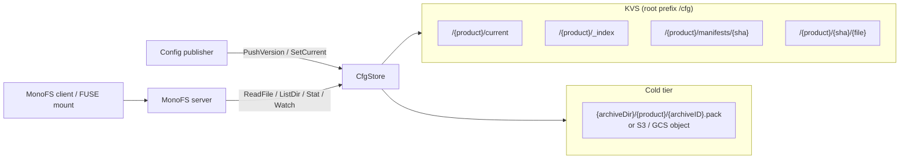

# cfg

`cfg` is a two-tier, versioned configuration store. It keeps the most recent
versions of a product's configuration in KVS (the hot tier) and moves older
versions into encrypted packager archives (the cold tier).

The package is consumed by MonoFS and Guardian for versioned configuration
distribution. Any `kvsapi.Store` can back the hot tier, and archives can live
locally, on S3, or on Google Cloud Storage.

## Architecture



`CfgStore` owns both tiers: reads check KVS then archives; writes use `PushVersion`.

## KVS key layout

Every product (for example `my-app`) is a namespace under a configurable root
prefix, `/cfg` by default:

```text
/cfg/my-app/current                 -> sha string (active version)
/cfg/my-app/_index                  -> JSON VersionIndex
/cfg/my-app/manifests/{sha}         -> JSON []FileRecord (per-version file list)
/cfg/my-app/{sha}/{file}            -> file content (hot tier)
```

Packager archives hold cold-tier content at
`{archiveDir}/{product}/{archiveID}.pack`; cloud object keys use
`{S3Prefix|GCSPrefix}{product}/{archiveID}.pack`.

## Version model

A product has an ordered list of versions, newest first, stored in the
`VersionIndex`.

### Push

`PushVersion(ctx, product, sha, files)` writes every file to
`/{root}/{product}/{sha}/{file}` and the per-version manifest to
`/{root}/{product}/manifests/{sha}` in one KVS mutation batch. It then registers
the version in `_index` through a compare-and-swap loop, retrying on
`kvsapi.ErrConflict`; re-pushing an existing SHA is a no-op for the index.
Finally it calls `Compact`; compaction failures do not fail the push.

### Current pointer

`SetCurrent(ctx, product, sha)` verifies that the SHA exists in the index, then
writes the SHA to `/{root}/{product}/current` using optimistic concurrency on
that file's KVS version ID. `GetCurrent` reads the pointer back.

`current` is virtual: reading or listing `/{root}/{product}/current/...`
resolves the pointer; product listings include it when a pointer is set.

### Compaction and archiving

The store keeps at most `MaxHotVersions` versions per product in KVS (default
5). When hot versions exceed that limit, `Compact`:

1. Selects the excess oldest hot versions.
2. Reads their content from KVS and builds one packager archive keyed
   internally as `{sha}/{file}`.
3. Updates `_index` with CAS: marks the versions `cold`, records their
   `archiveID`, and adds an `ArchiveRecord`.
4. Deletes the archived content from KVS.

Archives are encrypted with ChaCha20-Poly1305 and compressed with zstd. Reads
of cold versions open the archive recorded in the index.

Per-version manifests are never deleted. They keep file names, sizes,
modification times, and SHA-256 hashes, so directory listings and `Stat` work
for cold versions without opening an archive.

`Compact` retries index updates up to five times on CAS conflicts; if the update
cannot be committed, that attempt's archive is left unreferenced.

## MonoFS integration

`CfgStore` implements `kvsapi.ReadStore` and `kvsapi.WatchStore` plus the
management operations MonoFS needs, and is wired via `SetCfgStore`. A
repository is routed to the cfg backend when its `storage_backend` field is
`cfg`. For those repositories:

- Reads, directory listings, and `Stat` calls go through
  `CfgStore.ReadFile`, `ListDir`, and `Stat`.
- Watch requests are forwarded to the underlying KVS.
- Ingestion groups files by the leading SHA path component and calls
  `PushVersion` once per version; `BackendMetadata["cfg_set_current"] == "true"`
  triggers `SetCurrent` after a successful push.

## Public Go API

```go
func New(ctx context.Context, kvs kvsapi.Store, config Config) (*CfgStore, error)
```

`kvs` must be non-nil and `config.EncryptionKey` must be exactly 32 bytes.

| Method | Purpose |
| --- | --- |
| `PushVersion` | Write a version's files and manifest, then register it |
| `SetCurrent` / `GetCurrent` | Set or resolve the active SHA |
| `ListProductVersions` | List versions newest first |
| `Compact` | Archive excess hot versions |
| `ReadFile` / `ListDir` / `Stat` | Read hot or cold paths, resolving `current` |
| `Watch` | Delegate watches to the underlying KVS |
| `Close` | Release store resources |

KVS passthrough methods are also available: `UpsertFiles`, `DeletePaths`,
`ListVersions`, and `GetVersion`; prefer `PushVersion`/`SetCurrent`.

## Configuration

| Field | Default | Notes |
| --- | --- | --- |
| `RootPrefix` | `/cfg` | Leading slash, no trailing slash |
| `MaxHotVersions` | `5` | Values `<= 0` fall back to 5 |
| `ArchiveDir` | none | Required for local archives; also the local build directory for cloud uploads |
| `EncryptionKey` | none | Required, exactly 32 bytes |
| `Storage.Type` | `local` | `local`, `s3`, or `gcs` |

S3 options: `S3Region`, `S3Bucket` (required), `S3Prefix`, `S3Endpoint`,
`S3AccessKeyID`, `S3SecretAccessKey`, `S3SessionToken`, `S3UsePathStyle`. GCS
options: `GCSBucket` (required), `GCSPrefix`, `GCSCredentialsFile`,
`GCSCredentialsJSON` (takes precedence over the file).

Products and SHAs cannot contain `/` or null bytes and cannot start with `_` or
`.`; `_index` and `manifests` are reserved product names; `current` is a
reserved SHA. File paths must be relative, without `..` or empty components.

## Build and test

```sh
go build ./...
go test ./...
```

## License

Apache License 2.0. See [LICENSE](LICENSE).
